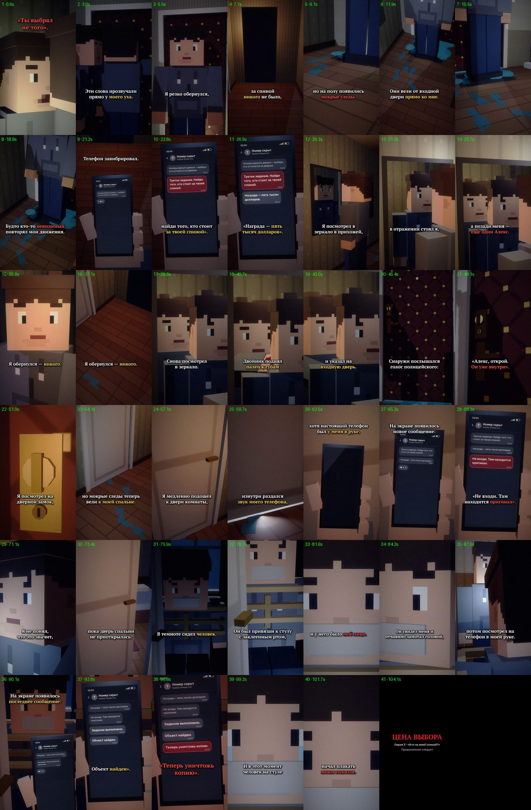

# EP03 — QC report

File: `renders/EP03_PRICE_OF_CHOICE_FINAL.mp4` · 81.0 MB · 105.30 s

Generated by `scripts/07_qc.py` from the finished file.

| Check | Result | Value |
|---|---|---|
| Video codec H.264 | ✅ | h264 (High), yuv420p |
| Resolution 1080×1920 (9:16) | ✅ | 1080×1920 |
| 30 fps | ✅ | 30/1 |
| Audio codec AAC | ✅ | aac, 48000 Hz, 2 ch |
| Duration = VO + cut + end card | ✅ | 105.30 s (VO 102.77 s) |
| File size under GitHub's 100 MB limit | ✅ | 81.0 MB |
| Frame count | ✅ | 3159 frames |
| Full decode without errors (playback test) | ✅ | ffmpeg decode: clean |
| No unintended black frames | ✅ | black only 103.00–105.27 (cut to black at 102.85) |
| No frozen picture ≥ 2.5 s before the end card | ✅ | none |
| Audio/VO sync (offset of the VO in the final track) | ✅ | +0.0 ms |
| Loudness for TikTok (−17…−13 LUFS) | ✅ | -15.1 LUFS |
| Voiceover file unchanged | ✅ | 5c71632532c3a1759728fd263270a611 |
| Subtitles inside the VO, no overlaps | ✅ | 43 cues |
| SRT: at most two lines per cue | ✅ | checked |
| All six required phone messages, exact text | ✅ | all present |
| First shot continues EP02's last shot | ✅ | E2_double_ear, EP02's end framing (0.47, 0.43, ×1.12) |
| EP01/EP02 files untouched | ✅ | no changes |

One frame from the middle of every shot (shot number · time):

