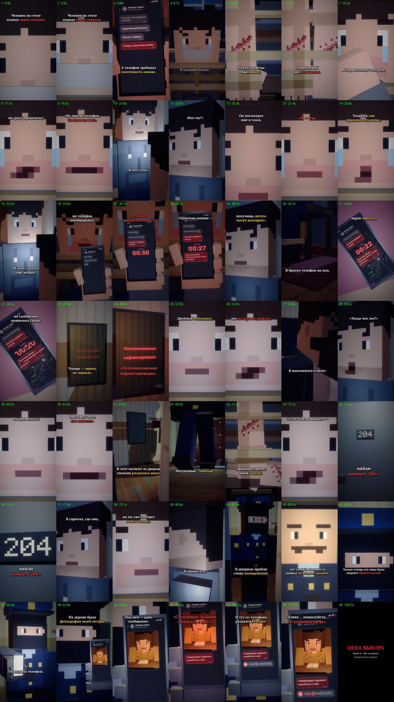

# EP04 — QC report

File: `renders/EP04_PRICE_OF_CHOICE_FINAL.mp4` · 85.0 MB · 110.73 s

Generated by `scripts/07_qc.py` from the finished file.

| Check | Result | Value |
|---|---|---|
| Video codec H.264 | ✅ | h264 (High), yuv420p |
| Resolution 1080×1920 (9:16) | ✅ | 1080×1920 |
| 30 fps | ✅ | 30/1 |
| Audio codec AAC | ✅ | aac, 48000 Hz, 2 ch |
| Duration = VO + cut + end card | ✅ | 110.73 s (VO 108.28 s) |
| File size under GitHub's 100 MB limit | ✅ | 85.0 MB |
| Frame count | ✅ | 3322 frames |
| Full decode without errors (playback test) | ✅ | ffmpeg decode: clean |
| No unintended black frames | ✅ | black only 108.47–110.70 (cut to black at 108.3) |
| No frozen picture ≥ 2.5 s before the end card | ✅ | none |
| Audio/VO sync (offset of the VO in the final track) | ✅ | +0.0 ms |
| Loudness for TikTok (−17…−13 LUFS) | ✅ | -14.8 LUFS |
| Voiceover file unchanged | ✅ | 604dc263c830c8817cd0f29c01cd713b |
| Subtitles inside the VO, no overlaps | ✅ | 48 cues |
| SRT: at most two lines per cue | ✅ | checked |
| All four required on-screen messages, exact text | ✅ | all present |
| No message appears before its words in the VO | ✅ | Осталось тридцать секу… 35.25s, Уничтожь копию. Получи… 37.27s, Следующее задание начн… 97.34s, Неповиновение зафиксир… 48.92s |
| First shot continues EP03's last shot | ✅ | E3_tied_face_tears_eyes, EP03's end framing (0.5, 0.43, ×1.18) |
| EP01–EP03 files untouched | ✅ | no changes |

One frame from the middle of every shot (shot number · time):

