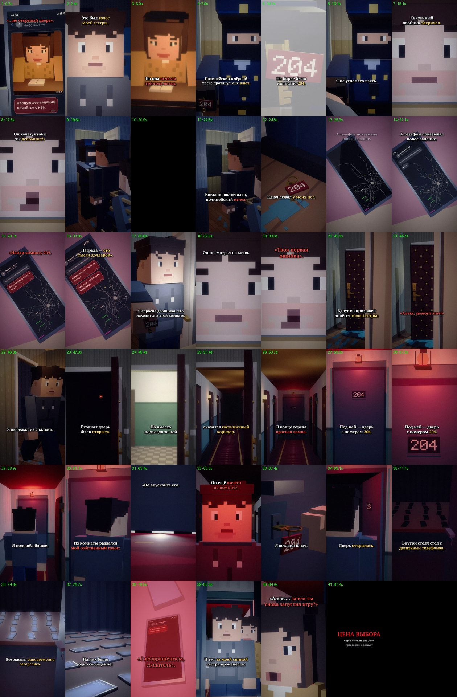

# EP05 — QC report

File: `renders/EP05_PRICE_OF_CHOICE_FINAL.mp4` · 68.0 MB · 88.60 s

Generated by `scripts/07_qc.py` from the finished file.

| Check | Result | Value |
|---|---|---|
| Video codec H.264 | ✅ | h264 (High), yuv420p |
| Resolution 1080×1920 (9:16) | ✅ | 1080×1920 |
| 30 fps | ✅ | 30/1 |
| Audio codec AAC | ✅ | aac, 48000 Hz, 2 ch |
| Duration = VO + cut + end card | ✅ | 88.60 s (VO 86.13 s) |
| Episode length in the 75–90 s target | ✅ | 88.60 s |
| File size under GitHub's 100 MB limit | ✅ | 68.0 MB |
| Frame count | ✅ | 2658 frames |
| Full decode without errors (playback test) | ✅ | ffmpeg decode: clean |
| No unintended black frames | ✅ | black only 20.17–21.50, 86.30–88.57 (scripted blackout 20.15–21.5, cut to black at 86.13) |
| No frozen picture ≥ 2.5 s before the end card | ✅ | none |
| Audio/VO sync (offset of the VO in the final track) | ✅ | +0.0 ms |
| Loudness for TikTok (−17…−13 LUFS) | ✅ | -14.6 LUFS |
| Voiceover file unchanged | ✅ | ad20d36b21d25dc3947d4b7d7528b554 |
| Subtitles inside the VO, no overlaps | ✅ | 38 cues |
| SRT: at most two lines per cue | ✅ | checked |
| All three required on-screen messages, exact text | ✅ | all present |
| No message appears before its words in the VO | ✅ | Найди комнату двести ч… 28.12s, Награда — сто тысяч до… 30.27s, С возвращением, создат… 78.08s |
| First shot continues EP04's last shot | ✅ | E4_cop_phone_close, EP04's end framing (0.5, 0.40, ×1.75), voice message played |
| EP01–EP04 files untouched | ✅ | no changes |

One frame from the middle of every shot (shot number · time):

