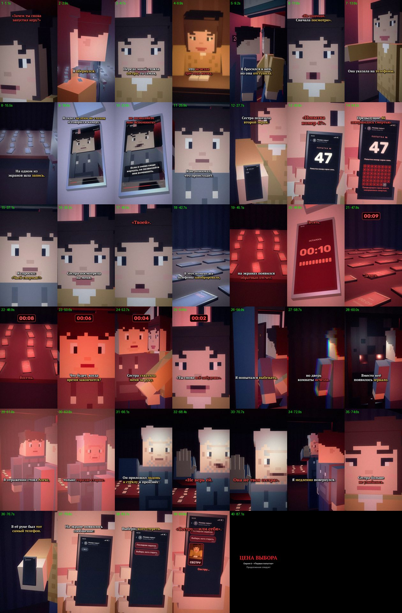

# EP06 — QC report

File: `renders/EP06_PRICE_OF_CHOICE_FINAL.mp4` · 67.6 MB · 88.30 s

Generated by `scripts/07_qc.py` from the finished file.

| Check | Result | Value |
|---|---|---|
| Video codec H.264 | ✅ | h264 (High), yuv420p |
| Resolution 1080×1920 (9:16) | ✅ | 1080×1920 |
| 30 fps | ✅ | 30/1 |
| Audio codec AAC | ✅ | aac, 48000 Hz, 2 ch |
| Duration = VO + cut + end card | ✅ | 88.30 s (VO 85.89 s) |
| Episode length in the 75–90 s target | ✅ | 88.30 s |
| File size under GitHub's 100 MB limit | ✅ | 67.6 MB |
| Frame count | ✅ | 2649 frames |
| Full decode without errors (playback test) | ✅ | ffmpeg decode: clean |
| No unintended black frames | ✅ | black only 86.10–88.27 (cut to black at 85.95) |
| No frozen picture ≥ 2.5 s before the end card | ✅ | none |
| Audio/VO sync (offset of the VO in the final track) | ✅ | +0.0 ms |
| Loudness for TikTok (−17…−13 LUFS) | ✅ | -14.5 LUFS |
| Voiceover file unchanged | ✅ | 8889e1001e7ac63829866ea166e648c5 |
| Subtitles inside the VO, no overlaps | ✅ | 42 cues |
| SRT: at most two lines per cue | ✅ | checked |
| All six required on-screen messages, exact text | ✅ | all present |
| No message appears before its words in the VO | ✅ | Если я снова сюда верн… 20.74s, Попытка номер сорок се… 29.96s, Предыдущие сорок шесть… 32.48s, Последнее задание.… 80.22s, Выбери, кого стереть.… 81.66s, Сестру или себя.… 83.92s |
| First shot continues EP05's last shot | ✅ | E5_sis lip-sync close-up, EP05's end framing (0.5, 0.44, ×1.25), same room 204 |
| Ends on the choice, no answer shown | ✅ | last shot: the choice screen «Сестру или себя», hard cut to black |
| EP01–EP05 files untouched | ✅ | no changes |

One frame from the middle of every shot (shot number · time):

