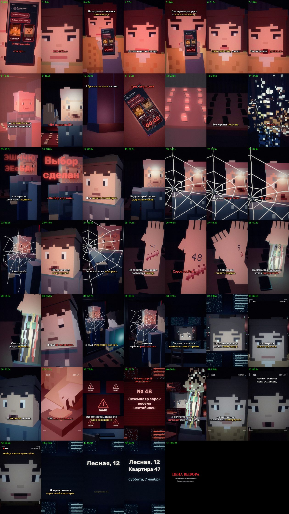

# EP07 — QC report

File: `renders/EP07_PRICE_OF_CHOICE_FINAL.mp4` · 79.5 MB · 103.13 s

Generated by `scripts/07_qc.py` from the finished file.

| Check | Result | Value |
|---|---|---|
| Video codec H.264 | ✅ | h264 (High), yuv420p |
| Resolution 1080×1920 (9:16) | ✅ | 1080×1920 |
| 30 fps | ✅ | 30/1 |
| Audio codec AAC | ✅ | aac, 48000 Hz, 2 ch |
| Duration = VO + cut + end card | ✅ | 103.13 s (VO 101.15 s) |
| Episode length in the 75–90 s target | ⚠️ | 103.13 s — the approved VO alone is 101.15 s; not sped up (as instructed) |
| File size under GitHub's 100 MB limit | ✅ | 79.5 MB |
| Frame count | ✅ | 3094 frames |
| Full decode without errors (playback test) | ✅ | ffmpeg decode: clean |
| No unintended black frames | ✅ | black only 22.90–23.00, 101.30–103.10 (cut to black at 101.15) |
| No frozen picture ≥ 2.5 s before the end card | ✅ | none |
| Audio/VO sync (offset of the VO in the final track) | ✅ | +0.0 ms |
| Loudness for TikTok (−17…−13 LUFS) | ✅ | -15.0 LUFS |
| Voiceover file unchanged | ✅ | fde19fce5c2529ec5dfb3bf75854744b |
| Subtitles inside the VO, no overlaps | ✅ | 49 cues |
| SRT: at most two lines per cue | ✅ | checked |
| All required on-screen texts, exact wording (drawn in code) | ✅ | all present; date: «ЗАВТРА» + «суббота, 7 ноября» (EP01 set the story on Friday 6 November) |
| No message appears before its words in the VO (the address only on «Лесная…») | ✅ | Выбор сделан 27.57s, Экземпляр… 75.20s, Начать удаление 77.54s, Лесная, 12 93.95s, Квартира 47 95.74s, ЗАВТРА 100.18s |
| First shot continues EP06's last shot | ✅ | E6_show_cold (her phone with the choice), EP06's end framing (0.76, 0.70, ×1.85), same room 204, no time jump |
| Ends on the address + tomorrow, hard cut | ✅ | last shot: «Лесная, 12 / Квартира 47», «суббота, 7 ноября», «ЗАВТРА», cut to black |
| EP01–EP06 files untouched | ✅ | no changes against the EP06 branch |

One frame from the middle of every shot (shot number · time):

