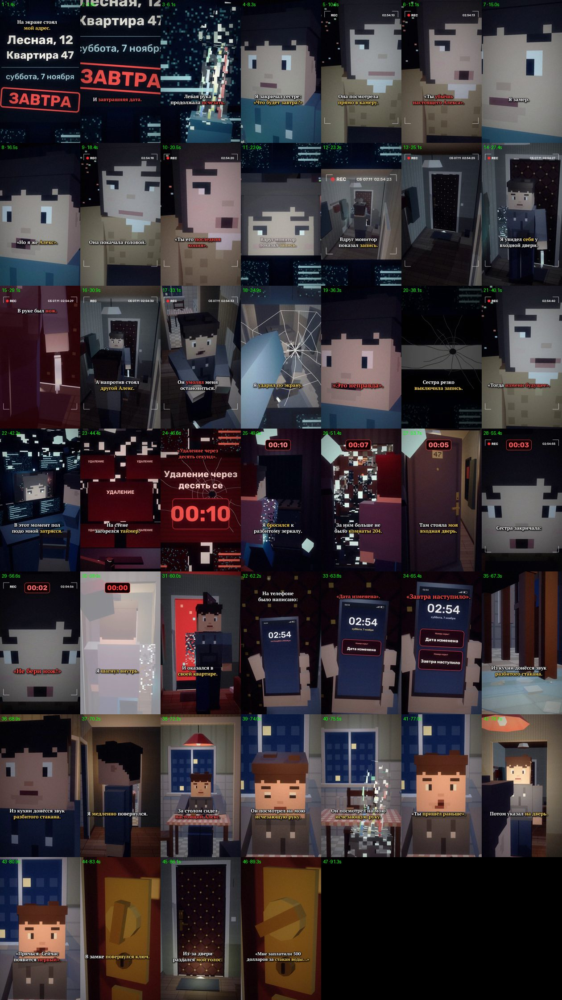

# EP08 — QC report

File: `renders/EP08_PRICE_OF_CHOICE_FINAL.mp4` · 71.4 MB · 91.63 s

Generated by `scripts/07_qc.py` from the finished file.

| Check | Result | Value |
|---|---|---|
| Video codec H.264 | ✅ | h264 (High), yuv420p |
| Resolution 1080×1920 (9:16) | ✅ | 1080×1920 |
| 30 fps | ✅ | 30/1 |
| Audio codec AAC | ✅ | aac, 48000 Hz, 2 ch |
| Duration = the MP3's duration | ✅ | 91.63 s (MP3 91.64 s) |
| Episode length in the 75–90 s target | ⚠️ | 91.63 s — the approved VO is 91.64 s (+1.64 s over 90 s); not sped up or cut (as instructed) |
| File size under GitHub's 100 MB limit | ✅ | 71.4 MB |
| Frame count | ✅ | 2749 frames |
| Full decode without errors (playback test) | ✅ | ffmpeg decode: clean |
| No unintended black frames | ✅ | black only 91.00–91.60 (cut to black at 90.97) |
| No frozen picture ≥ 2.5 s before the cut | ✅ | none |
| Audio/VO sync (offset of the VO in the final track) | ✅ | +0.0 ms |
| Loudness for TikTok (−17…−13 LUFS) | ✅ | -14.4 LUFS |
| Voiceover file unchanged | ✅ | 72d29ba82434e0534d17d7f3e27b666c |
| Last line not cut (audio present to the last word «воды») | ✅ | RMS 0.118 in the last 0.35 s of «воды» |
| Silence after the cut | ✅ | RMS 0.0000 after 91.42 s |
| Subtitles inside the VO, no overlaps | ✅ | 44 cues |
| Subtitles synced to the spoken words (start/end within 0.12 s of a word or pause boundary) | ✅ | all cues |
| SRT: at most two lines per cue | ✅ | checked |
| All required on-screen texts, exact wording (drawn in code) | ✅ | all present; date: «суббота, 7 ноября» + «ЗАВТРА» (as EP07 set it; EP01 = Friday 6 November) |
| No message appears before its words in the VO | ✅ | Удаление через десять секунд 45.50s, таймер на стене 43.95s, Дата изменена 63.16s, Завтра наступило 64.68s, запись на мониторе 22.45s |
| First shot continues EP07's last shot | ✅ | E7_mon (the address + «суббота, 7 ноября» + «ЗАВТРА»), EP07's end framing (0.5, 0.5, ×1.2), the monitor room, no time jump |
| Ends on EP01's first line behind the door, hard cut, nothing after it | ✅ | «Мне заплатили 500 долларов за стакан воды» = EP01 «Мне заплатили 500 долларов за стакан воды»; last shot: the lock turning (nobody shown), cut to black at 90.97 s |
| EP01–EP07 files untouched | ✅ | no changes against the EP07 branch (EP01 lives in its own branches and is not in this one) |

One frame from the middle of every shot (shot number · time):

