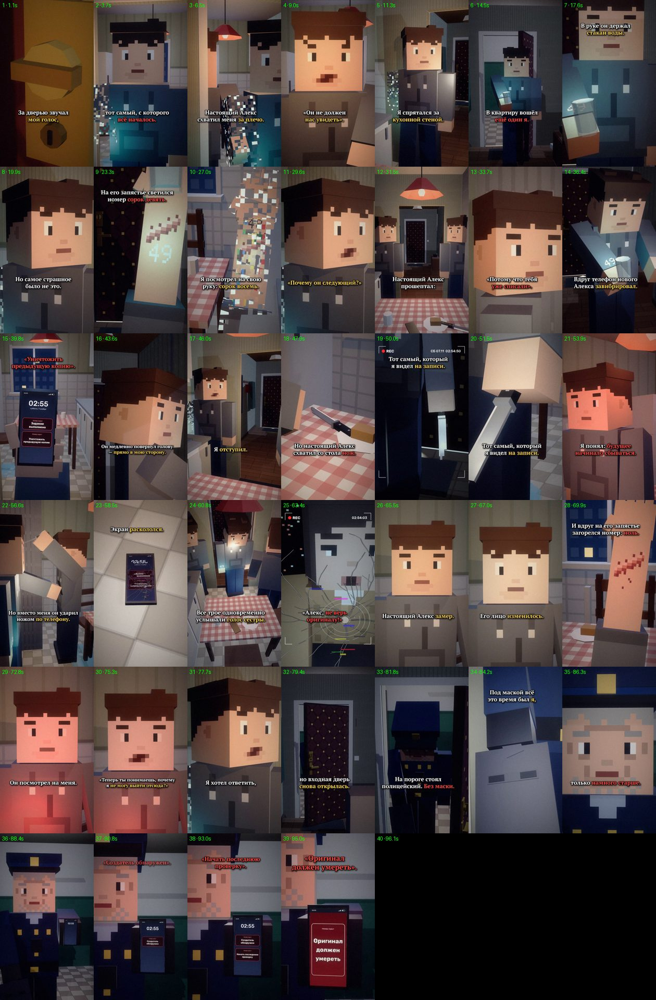

# EP09 — QC report

File: `renders/EP09_PRICE_OF_CHOICE_FINAL.mp4` · 75.0 MB · 96.13 s

Generated by `scripts/07_qc.py` from the finished file.

| Check | Result | Value |
|---|---|---|
| Video codec H.264 | ✅ | h264 (High), yuv420p |
| Resolution 1080×1920 (9:16) | ✅ | 1080×1920 |
| 30 fps | ✅ | 30/1 |
| Audio codec AAC | ✅ | aac, 48000 Hz, 2 ch |
| Duration = the MP3's duration | ✅ | 96.13 s (MP3 96.13 s) |
| Episode length in the 75–90 s target | ⚠️ | 96.13 s — the approved VO is 96.13 s (+6.13 s over 90 s); not sped up or cut (as instructed) |
| File size under GitHub's 100 MB limit | ✅ | 75.0 MB |
| Frame count | ✅ | 2883 frames |
| Full decode without errors (playback test) | ✅ | ffmpeg decode: clean |
| No unintended black frames | ✅ | black only — (cut to black at 96.02) |
| No frozen picture ≥ 2.5 s before the cut | ✅ | none |
| Audio/VO sync (offset of the VO in the final track) | ✅ | +0.0 ms |
| Loudness for TikTok (−17…−13 LUFS) | ✅ | -14.4 LUFS |
| Voiceover file unchanged | ✅ | 62650f060ac37ef75feffc0c56a1e4d1 |
| Last line not cut (audio present to the last word «умереть») | ✅ | RMS 0.128 in the last 0.35 s of «умереть» |
| No speech after the cut (the VO itself is silent from the cut to the end of the file) | ✅ | VO RMS 0.0036 after 96.02 s |
| Black after the cut, nothing after the last line | ✅ | black 96.02–96.13 s (the MP3 ends 96.13 s) |
| Subtitles inside the VO, no overlaps | ✅ | 42 cues |
| Subtitles synced to the spoken words (start/end within 0.12 s of a word or pause boundary) | ✅ | all cues |
| SRT: at most two lines per cue | ✅ | checked |
| All required on-screen texts, exact wording (drawn in code) | ✅ | all present (phone UI in scripts/phone_ui.py, series fonts) |
| No message appears before its words in the VO | ✅ | «Задание выполнено» 37.96s, «Уничтожить предыдущую копию» 39.34s, «Создатель обнаружен» 90.68s, «Начать последнюю проверку» 92.10s, «Оригинал должен умереть» 94.06s |
| Final order on screen at the right moment, then the cut | ✅ | «Оригинал должен умереть» full-screen from 94.06 s on the close-up of his phone; hard cut at 96.02 s on the end of «умереть» |
| Wrist numbers not mixed up (48 = ALEX_48, 49 = ALEX_49, 0 = ALEX_ZERO) | ✅ | 48: ALEX_48's own forearm (EP07 ink, E9_wrist48); 49: ALEX_49 only (a49(), E9_wrist49, cyan); 0: ALEX_ZERO only, from 69.80 s (E9_wrist0, red) |
| First shot continues EP08's last shot | ✅ | EP08's E8_lock shot re-rendered (thumb-turn fully turned), EP08's end framing ×1.24, flat 47, no time jump |
| EP01–EP08 files untouched | ✅ | no changes against the EP08 branch (EP01 lives in its own branches and is not in this one) |

One frame from the middle of every shot (shot number · time):

