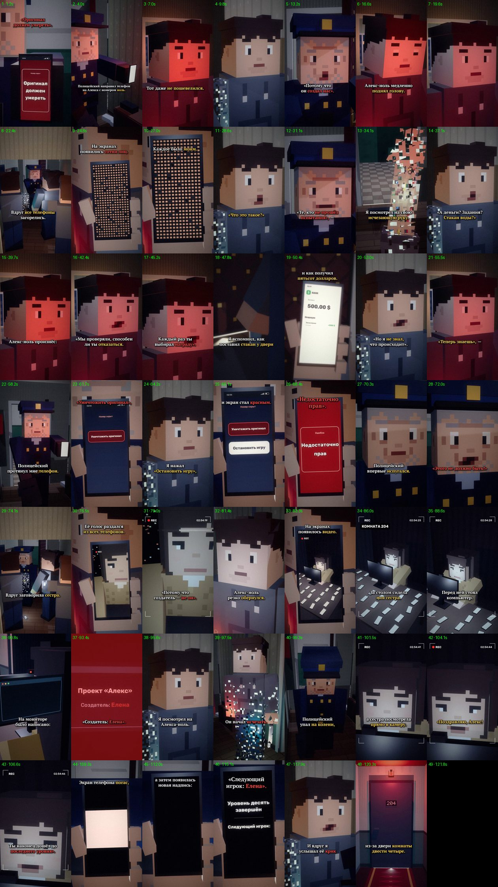

# EP10 — QC report

File: `renders/EP10_PRICE_OF_CHOICE_FINAL.mp4` · 94.9 MB · 121.80 s

Generated by `scripts/07_qc.py` from the finished file.

| Check | Result | Value |
|---|---|---|
| Video codec H.264 | ✅ | h264 (High), yuv420p |
| Resolution 1080×1920 (9:16) | ✅ | 1080×1920 |
| 30 fps | ✅ | 30/1 |
| Audio codec AAC | ✅ | aac, 48000 Hz, 2 ch |
| Duration = the MP3's duration | ✅ | 121.80 s (MP3 121.81 s) |
| Episode length in the 75–90 s target | ⚠️ | 121.80 s — the approved VO is 121.81 s (+31.81 s over 90 s); not sped up or cut (as instructed) |
| File size under GitHub's 100 MB limit | ✅ | 94.9 MB |
| Frame count | ✅ | 3654 frames |
| Full decode without errors (playback test) | ✅ | ffmpeg decode: clean |
| No unintended black frames | ✅ | black only — (cut to black at 121.74) |
| No frozen picture ≥ 2.5 s before the cut | ✅ | none |
| Audio/VO sync (offset of the VO in the final track) | ✅ | +0.0 ms |
| Loudness for TikTok (−17…−13 LUFS) | ✅ | -14.9 LUFS |
| Voiceover file unchanged | ✅ | f09ce98e8261e676fe39c7814f4e920d |
| Last line not cut (audio present to the last word «…четыре») | ✅ | RMS 0.191 in the last 0.35 s of «четыре» |
| No speech after the cut (the VO itself is silent from the cut to the end of the file) | ✅ | VO RMS 0.0012 after 121.74 s |
| Black after the cut, nothing after the last line | ✅ | black 121.74–121.81 s (the MP3 ends 121.81 s) |
| Subtitles inside the VO, no overlaps | ✅ | 58 cues |
| Subtitles synced to the spoken words (start within 0.12 s of a word start; end on a word end or inside the pause after it) | ✅ | all cues |
| SRT: at most two lines per cue | ✅ | checked |
| All required on-screen texts, exact wording (drawn in code) | ✅ | all 8 present (phone/monitor UI in scripts/phone_ui.py, series fonts) |
| No message appears before its words in the VO | ✅ | «Уничтожить оригинал» 60.64s, «Остановить игру» 62.15s, «Недостаточно прав» 67.53s, «Проект «Алекс»» 91.05s, «Создатель: Елена» 92.27s, «Уровень десять завершён» 112.26s, «Следующий игрок: Елена» 114.34s; «Оригинал должен умереть» is EP09's last frame, carried over (spoken at 0.12 s) |
| Ending: «Следующий игрок: Елена», then the scream, door 204, hard cut | ✅ | name 115.73 s → scream 119.05 s (procedural muffled cry, no words) → door 204 → cut 121.74 s; the sister's fate not shown |
| Wrist numbers not mixed up (48 = ALEX_48, 49 = ALEX_49, 0 = ALEX_ZERO) | ✅ | 48: ALEX_48's forearm (E10_hand48, EP07 ink); 49: ALEX_49 only (a49()); 0: ALEX_ZERO only (cast10 → zero(…, {num0: true})) |
| First shot continues EP09's last frame | ✅ | EP09's E9_cop_screen_close still (read from ../EP09/scenes), its final red screen «Оригинал должен умереть», flat 47, no time jump |
| EP01–EP09 files untouched | ✅ | no changes against the EP09 branch (EP01 lives in its own branches and is not in this one) |

One frame from the middle of every shot (shot number · time):

