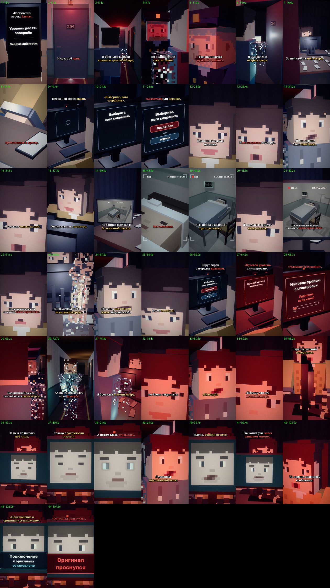

# EP11 — QC report

File: `renders/EP11_PRICE_OF_CHOICE_FINAL.mp4` · 84.4 MB · 108.12 s

Generated by `scripts/07_qc.py` from the finished file.

| Check | Result | Value |
|---|---|---|
| Video codec H.264 | ✅ | h264 (High), yuv420p |
| Resolution 1080×1920 (9:16) | ✅ | 1080×1920 |
| 30 fps | ✅ | 30/1 |
| Audio codec AAC | ✅ | aac, 48000 Hz, 2 ch |
| Duration = the MP3's duration | ✅ | 108.12 s (MP3 108.12 s) |
| Episode length in the 75–90 s target | ⚠️ | 108.12 s — the approved VO is 108.12 s (+18.12 s over 90 s); not sped up or cut (as instructed) |
| File size under GitHub's 100 MB limit | ✅ | 84.4 MB |
| Frame count | ✅ | 3243 frames |
| Full decode without errors (playback test) | ✅ | ffmpeg decode: clean |
| No black frames | ✅ | black: none |
| No frozen picture ≥ 2.5 s | ✅ | none |
| Audio/VO sync (offset of the VO in the final track) | ✅ | +0.0 ms |
| Loudness for TikTok (−17…−13 LUFS) | ✅ | -14.8 LUFS |
| Voiceover file unchanged | ✅ | 5974a54f41fada113993a12605b97d1a |
| Last line not cut (audio present to the last word «…проснулся») | ✅ | RMS 0.124 in the last 0.35 s of «проснулся» |
| The episode ends on the last word (no black tail, no end card) | ✅ | last shot E11_face_close (monitor face11) to 108.12 s = the MP3's end |
| Subtitles inside the VO, no overlaps | ✅ | 48 cues |
| Subtitles synced to the spoken words (start within 0.12 s of a word start; end on a word end or inside the pause after it) | ✅ | all cues |
| SRT: at most two lines per cue | ✅ | checked |
| All required on-screen texts, exact wording (drawn in code) | ✅ | all 7 present (phone/monitor UI in scripts/phone_ui.py, series fonts) |
| No message appears before its words in the VO | ✅ | «Следующий игрок» 0.13s (said 0.13s), «Елена (next player)» 1.91s (said 1.91s), «Выберите, кого сохранить» 20.39s (said 20.39s), «Создателя» 22.42s (said 22.42s), «или игрока» 23.48s (said 23.48s), «красный экран» 62.05s (said 61.04s), «Нулевой уровень активирован» 63.17s (said 63.17s), «Удаление всех копий» 65.75s (said 65.75s), «лицо на экране» 86.42s (said 86.42s), «глаза открылись» 91.35s (said 90.75s), «Подключение к оригиналу установлено» 103.62s (said 103.62s), «Оригинал проснулся» 106.89s (said 106.89s) |
| Ending: the original wakes — «Подключение к оригиналу установлено», then «Оригинал проснулся» on the last frame | ✅ | «Подключение к оригиналу установлено» 103.62 s → «Оригинал проснулся» 106.89 s → file ends 108.12 s; nothing of what the original does next |
| Wrist numbers not mixed up (48 = ALEX_48, 49 = ALEX_49; ALEX_ZERO and his 0 not on screen) | ✅ | 48: ALEX_48's forearm (E11_hand, EP07 ink); 49: ALEX_49 only (a49(), E11_a49_dust); no «0» anywhere in EP11 |
| First shot continues EP10's last screen | ✅ | EP10's E10_pov_end still (read from ../EP10/scenes) with EP10's final screen, then door 204 under the red lamp (EP10's last shot) — no time jump |
| EP01–EP10 files untouched | ✅ | no changes against the EP10 branch (EP01 lives in its own branches and is not in this one) |

One frame from the middle of every shot (shot number · time):

