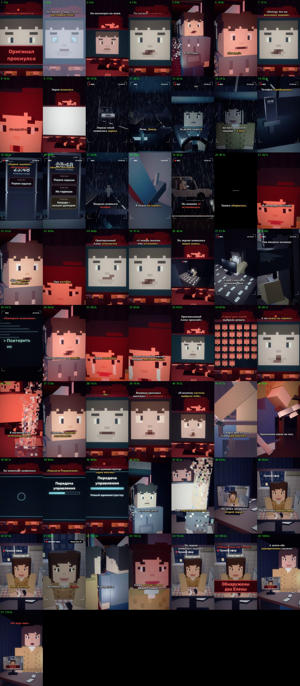

# EP12 — QC report

File: `renders/EP12_PRICE_OF_CHOICE_FINAL.mp4` · 86.6 MB · 110.92 s

Generated by `scripts/07_qc.py` from the finished file.

| Check | Result | Value |
|---|---|---|
| Video codec H.264 | ✅ | h264 (High), yuv420p |
| Resolution 1080×1920 (9:16) | ✅ | 1080×1920 |
| 30 fps | ✅ | 30/1 |
| Audio codec AAC | ✅ | aac, 48000 Hz, 2 ch |
| Duration = the MP3's duration | ✅ | 110.92 s (MP3 110.92 s) |
| Episode length in the 75–90 s target | ⚠️ | 110.92 s — the approved VO is 110.92 s (+20.92 s over 90 s); not sped up or cut (as instructed) |
| File size under GitHub's 100 MB limit | ✅ | 86.6 MB |
| Frame count | ✅ | 3327 frames |
| Full decode without errors (playback test) | ✅ | ffmpeg decode: clean |
| No black frames | ❌ | black: 38.03–38.70 |
| No frozen picture ≥ 2.5 s | ✅ | none |
| Audio/VO sync (offset of the VO in the final track) | ✅ | +0.0 ms |
| Loudness for TikTok (−17…−13 LUFS) | ✅ | -14.5 LUFS |
| Voiceover file unchanged | ✅ | 097cedfe5c6498c64ff763cd0faf69a2 |
| Last line not cut (audio present to the last word «…мне») | ✅ | RMS 0.104 in the last 0.35 s of «Не верь мне» |
| The episode ends on the last word (no black tail, no end card) | ✅ | last shot LIPSYNC/E12_two (monitor live12) to 110.92 s = the MP3's end |
| Subtitles inside the VO, no overlaps | ✅ | 59 cues |
| Subtitles synced to the spoken words (start within 0.12 s of a word start; end on a word end or inside the pause after it) | ✅ | all cues |
| SRT: at most two lines per cue | ✅ | checked |
| All required on-screen texts, exact wording (drawn in code) | ✅ | all 7 present (phone/monitor UI in scripts/phone_ui.py, series fonts; «сорок восемь» is drawn as a big «48») |
| No message appears before its words in the VO | ❌ | 48 (88.92 < None) |
| Ending: both Elenas on screen at «Не верь мне» (ELENA_204 lip-synced + ELENA_APARTMENT on the live feed, lip-synced) | ✅ | last shot from 110.00 s: E12_two_* (ELENA_204) with draw_live12 (E12_flatfeed_*) on the side monitor; «Не верь мне» 110.06–110.92 s; which one is real is not shown |
| Hand continuity: disappearing until the handover, whole only from «Она перестала исчезать» | ✅ | 6 ALEX_48 shots with the hand going (van 0.74, EP11's state) all end by 91.57 s; E12_hand_stop 91.57 s: the blocks come back; after: whole |
| Accident: no collision shown, the record breaks off first; he brakes, the car does not stop | ✅ | E12_ahead (person in the headlights) → E12_brake (foot on the pedal, brake lights) → E12_skid (side-on, wheels locked, still moving) → static/black at «Запись оборвалась»; no contact, no injuries |
| Both Elenas identical (same model, same clothes, same face set) | ✅ | ELENA_204 = makePerson('sister'); ELENA_APARTMENT = sisterSeated(same face tokens) — no extra marks on either |
| ALEX_OLD_POLICE and ALEX_49 not brought back | ✅ | neither is placed in any E12_* shot |
| First shot continues EP11's last screen | ✅ | EP11's E11_face_close still (read from ../EP11/scenes), «Оригинал проснулся» still on the screen until it clears — same place, no time jump, no recap |
| EP01–EP11 files untouched | ✅ | no changes against the EP11 branch (EP01 lives in its own branches and is not in this one) |

One frame from the middle of every shot (shot number · time):

