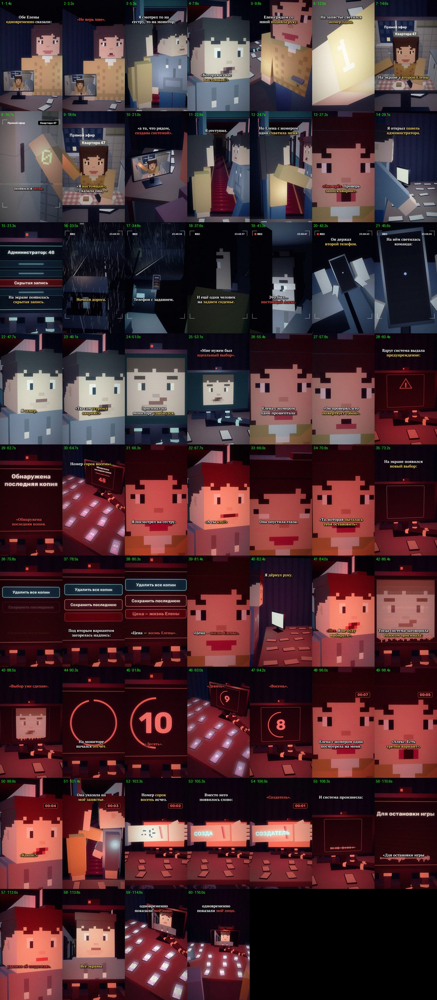

# EP13 — QC report

File: `renders/EP13_PRICE_OF_CHOICE_FINAL.mp4` · 91.1 MB · 116.60 s

Generated by `scripts/07_qc.py` from the finished file.

| Check | Result | Value |
|---|---|---|
| Video codec H.264 | ✅ | h264 (High), yuv420p |
| Resolution 1080×1920 (9:16) | ✅ | 1080×1920 |
| 30 fps | ✅ | 30/1 |
| Audio codec AAC | ✅ | aac, 48000 Hz, 2 ch |
| Duration = the MP3's duration | ✅ | 116.60 s (MP3 116.61 s) |
| Episode length in the 75–90 s target | ⚠️ | 116.60 s — the approved VO is 116.61 s (+26.61 s over 90 s); not sped up or cut (as instructed) |
| File size under GitHub's 100 MB limit | ✅ | 91.1 MB |
| Frame count | ✅ | 3498 frames |
| Full decode without errors (playback test) | ✅ | ffmpeg decode: clean |
| No empty/black frames | ✅ | black: none |
| No frozen picture ≥ 2.5 s | ✅ | none |
| Audio/VO sync (offset of the VO in the final track) | ✅ | +0.0 ms |
| Loudness for TikTok (−17…−13 LUFS) | ✅ | -15.2 LUFS |
| Voiceover file unchanged | ✅ | 1b88f317c35291d93b1e933f0c30e1de |
| Last line not cut (audio present to the last word «…лицо») | ✅ | RMS 0.105 in «…моё лицо» (115.6–116.25 s); the file ends at 116.61 s |
| The episode ends on the last word (no black tail, no end card) | ✅ | last shot E13_all/None (monitor self13) to 116.61 s = the MP3's end |
| Subtitles inside the VO, no overlaps | ✅ | 60 cues |
| Subtitles synced to the spoken words (start within 0.12 s of a word start; end on a word end or inside the pause after it) | ✅ | all cues |
| SRT: at most two lines per cue | ✅ | checked |
| All required on-screen texts, exact wording (drawn in code, series fonts) | ✅ | all 8 present: «Отключить тормоза» · «Обнаружена последняя копия» · «Номер сорок восемь» · «Удалить все копии» · «Сохранить последнюю» · «Цена — жизнь Елены» · «СОЗДАТЕЛЬ» · «Для остановки игры удалите её создателя» |
| No message appears before its words in the VO | ✅ | «номер 1 горит» 10.86s (said 10.84s), «ноль на экране» 16.06s (said 16.06s), «скрытая запись» 30.62s (said 30.62s), «Отключить тормоза» 45.75s (said 45.75s), «улыбка оригинала» 50.12s (said 50.12s), «Обнаружена последняя копия» 61.72s (said 61.72s), «Номер сорок восемь» 63.87s (said 63.87s), «выбор» 72.28s (said 72.28s), «Удалить все копии» 74.39s (said 74.39s), «Сохранить последнюю» 75.79s (said 75.79s), «Цена — жизнь Елены» 79.76s (said 79.76s), «10» 91.33s (said 91.33s), «9» 92.43s (said 92.43s), «8» 93.63s (said 63.87s), «48 исчезает» 102.55s (said 102.55s), «буквы СОЗДАТЕЛЬ» 104.32s (said 104.32s), «СОЗДАТЕЛЬ целиком» 106.33s (said 106.33s), «Для остановки игры» 109.29s (said 109.29s), «удалите её создателя» 110.90s (said 110.90s), «все экраны — его лицо» 113.36s (said 113.36s) |
| Opening = EP12's last frame (both Elenas, «Не верь мне»), no recap, no time jump | ✅ | EP12's E12_two still (read from ../EP12/scenes) with the live feed; EP12's last camera position (.5, .4, 1.14) continued; both mouth «Не верь мне» 2.77–3.60 s |
| Two Elenas told apart: ELENA_1 in room 204 (cold, «1»), ELENA_0 on the flat-47 feed (warm kitchen, red «0») | ✅ | same sister model for both (sis204 / sisterSeated), no other differences; «1» macro 10.86–13.20 s, «0» on the feed 16.00–17.45 s |
| ALEX_48: «48» on the wrist until it vanishes, then «СОЗДАТЕЛЬ» | ✅ | E13_arm: «48» dissolves 102.55–103.95 s; «СОЗДАТЕЛЬ» burns in from 104.32 s, locks 106.33 s |
| Hidden recording = EP12's night: same road, car, rain, cast, dashboard phone; the original on the back seat with the second phone; no collision | ✅ | car13 = EP12's car12 + a back bench and the original (plain ALEX model); EP12's dashboard phone with its three task cards; «Отключить тормоза» on the second phone; no impact, no blood |
| Ending: every screen shows ALEX_48's face, hard cut on the last word | ✅ | from 113.36 s: the turned computer, the side monitor and every phone on the table show the webcam picture of ALEX_48; the file ends 116.61 s |
| No ALEX_ZERO, no events after the last line | ✅ | the original is a plain ALEX figure (recording) and a face on the screen only |
| EP01–EP12 files untouched | ✅ | no changes against the EP12 branch (EP01 lives in its own branches and is not in this one) |

One frame from the middle of every shot (shot number · time):

